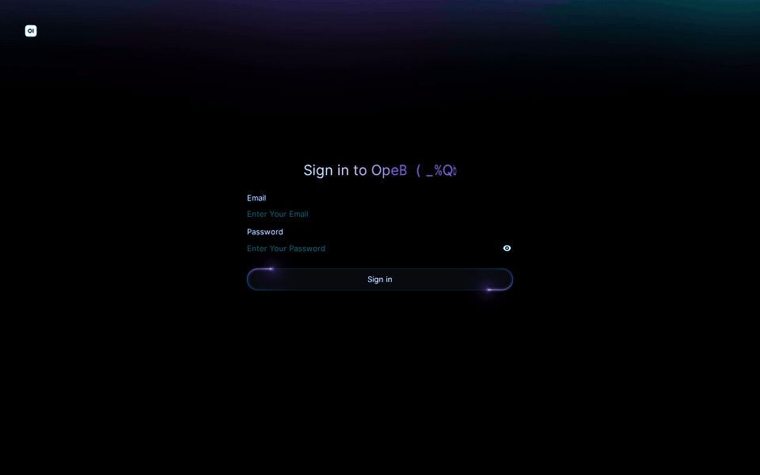
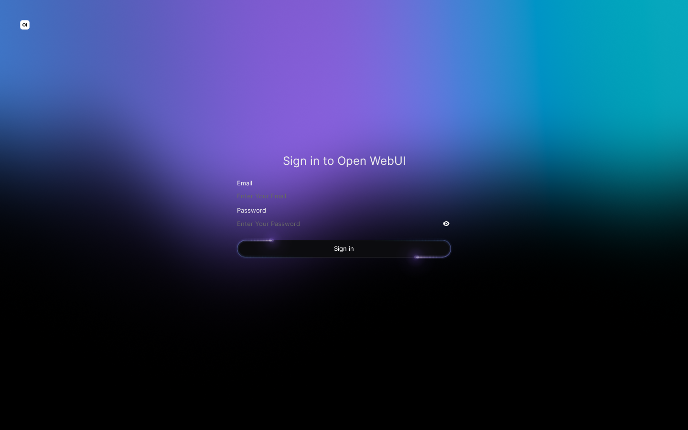
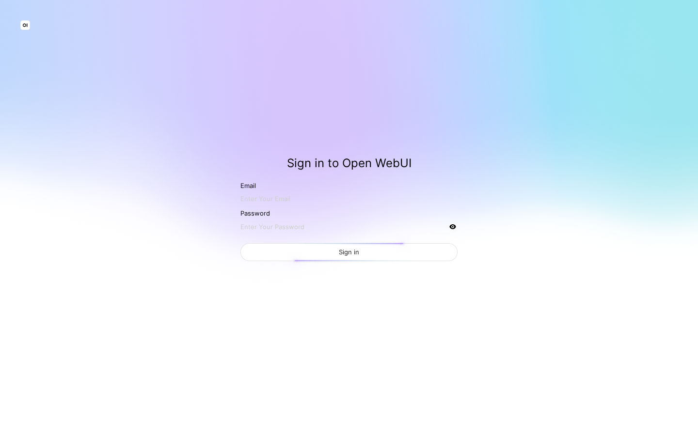
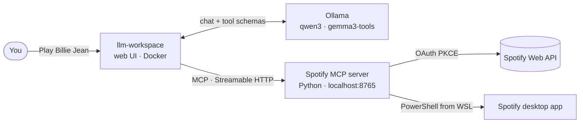

<div align="center">

# llm-workspace

### A private AI assistant that runs entirely on your computer and can act on it.

Chat with local LLMs, give them tools through the **Model Context Protocol (MCP)**, and control apps like Spotify in plain English or Greek. No cloud, no API bills, no data leaving your machine.




</div>

---

## In 30 seconds

| | |
|---|---|
| **What it is** | A self-hosted AI workspace built on [Open WebUI](https://github.com/open-webui/open-webui), extended into a **local AI agent** that can use tools. |
| **What it does** | You type *"Play Billie Jean"* and a small model running on your CPU picks the right tool, calls a custom **MCP server**, and the song starts on your computer. |
| **Why it matters** | It covers the full path of a production AI agent: **model selection, tool design, MCP integration, safety guardrails, testing and evaluation**, on modest hardware. |
| **How to try it** | `git clone` → `./start.sh` → open `localhost:3000`. |

---

## Highlights

### 🤖 A local AI agent with MCP tools
A custom **Spotify MCP server** gives the model 7 tools. It is connected automatically on start.

> **You:** *Άλλαξε τραγούδι, βάλε Thriller*
> **Model:** calls `play_music(query="Thriller")` → **Playing Thriller — Michael Jackson on My-PC.**

| Tool | What you can say |
|---|---|
| `play_music` | "Play Bohemian Rhapsody", "Put on something by Queen" |
| `playback` | "Pause", "Skip this song", "Restart this song" |
| `search_music` | "Find songs by Sakis Rouvas" |
| `now_playing` | "What's playing right now?" |
| `open_spotify` · `close_spotify` · `restart_spotify` | "Open Spotify", "Close Spotify" |

**Built like production software:**
- **Two backends, one interface.** Uses the Spotify Web API (OAuth 2.0 with PKCE, so no client secret anywhere) and falls back to controlling the desktop app from WSL when the API can't help. Works with any account out of the box.
- **Safe by design.** No free-form commands ever reach the shell; user text is percent-encoded into `spotify:` URIs (covered by injection tests). The server binds to localhost only, has DNS-rebinding protection, and keeps an audit log of every tool call.
- **Robust behaviour.** Never toggles play/pause blindly (it checks the player state first), and when no device is active it finds your computer and plays there.
- **41 unit tests** with fakes for Spotify and Windows, so the suite never touches your machine.

### 🧠 Tool calling for models that don't support it
Gemma 3 is rejected by Ollama for tool use (*"does not support tools"*). I wrote a custom chat template ([`models/gemma3-tools`](models/gemma3-tools/Modelfile)) that teaches it to call functions, then iterated on it against a tool-selection test set:

| Version | Correct tool calls |
|---|---|
| Stock `gemma3:4b` | ❌ rejected by Ollama |
| First template | 4 / 7 |
| **Final template** | **5 / 7**, every action request correct |

### ⚡ Tuned for CPU inference
Profiling showed replies were slow because every message also triggered hidden background generations (tags, follow-up questions), queued behind the answer on a single CPU worker. Turning them off removes two extra model calls from every message, and models now stay loaded between chats instead of reloading. The fastest tool-capable model, `gemma3-tools`, answers a greeting in **≈ 4 s** on a laptop CPU.

### 🎨 Redesigned, animated interface
A consistent blue, violet and cyan theme built from WebGL and CSS components ([Svelte Bits](https://github.com/DavidHDev/svelte-bits)): an aurora sign-in, an animated app backdrop, glowing composer, click sparks and a rebuilt, more readable settings window. Every effect follows light/dark mode and respects *reduce motion*.

<table>
  <tr>
    <td></td>
    <td></td>
  </tr>
  <tr>
    <td align="center"><sub>Dark theme</sub></td>
    <td align="center"><sub>Light theme</sub></td>
  </tr>
</table>

<!--
More media (save the files in docs/assets/ and uncomment):


-->

### 🧹 A leaner codebase
Removed **65 unreachable frontend files** (found with a custom import-graph analysis, each verified before deletion), **15 unused npm packages** and upstream release pipelines that don't apply here.

---

## How it works



1. You send a message; the web UI passes it to the local model together with the tools the MCP server exposes.
2. The model decides whether a tool is needed and returns a structured call, e.g. `play_music(query="Billie Jean")`.
3. The web UI forwards the call to the MCP server, which uses the Spotify API or the desktop app and returns a short result.
4. The model turns the result into a reply.

---

## Tech stack

| Area | Technologies |
|---|---|
| **AI & agents** | Ollama, Qwen 3, Gemma 3, custom Modelfile templates, Model Context Protocol (Python SDK, Streamable HTTP) |
| **Backend & tools** | Python 3.13, FastAPI, spotipy (Spotify Web API, OAuth 2.0 PKCE), pydantic-settings, uv |
| **Frontend** | SvelteKit, Svelte 5, TypeScript, Tailwind CSS v4, WebGL2 |
| **Quality** | pytest (41 tests), tool-calling evaluation probes, security checks for injection and secrets |
| **Infrastructure** | Docker, Bash automation, WSL2 ↔ Windows integration |

---

## Quick start

**You need:** [Docker](https://docs.docker.com/get-docker/), [Ollama](https://ollama.com) and [uv](https://docs.astral.sh/uv/) (`curl -LsSf https://astral.sh/uv/install.sh | sh`).

```bash
git clone https://github.com/kotsarakos/llm-workspace.git
cd llm-workspace
./start.sh
```

Open **http://localhost:3000**. The first account you create becomes the administrator. Then pick `qwen3:4b` or `gemma3-tools` and ask *"Open Spotify"*.

`start.sh` checks the prerequisites, pulls the default model on first run, builds the custom models, starts the MCP servers and the web UI, and connects them.

| Command | What it does |
|---|---|
| `./start.sh` | Start everything |
| `./stop.sh` | Stop everything (your data is kept) |
| `./start.sh --rebuild` | Rebuild the web UI from source, then start |

Everything works with defaults. To change the port or model, or to connect the Spotify Web API for search results and direct playback: `cp workspace.env.example workspace.env`, edit it, and see the [Spotify server guide](mcp-servers/spotify/README.md).

---

## Project structure

| Path | What's inside |
|---|---|
| [`mcp-servers/`](mcp-servers/) | Custom MCP servers, one folder per server |
| [`mcp-servers/spotify/`](mcp-servers/spotify/) | Spotify MCP server: tools, Web API client, desktop control, tests |
| [`models/`](models/) | Custom Ollama models (`gemma3-tools`) |
| `start.sh` · `stop.sh` | One-command start and stop |
| `workspace.env.example` | All optional settings |
| `src/lib/components/svelte-bits/` | Animated UI components and the shared theme |
| `src/`, `backend/` | The Open WebUI application this project builds on |

---

## Roadmap
- [x] Local agent with a Spotify MCP server
- [x] Tool calling for Gemma 3
- [x] One-command setup
- [ ] Tool-calling benchmark across models (accuracy and latency)
- [ ] More MCP servers: email with human approval, calendar, files
- [ ] Agentic RAG over personal documents (multi-agent, LangGraph)
- [ ] CI pipeline with tests and evaluations

---

## License & credits

- **Open WebUI**: this project is built on [Open WebUI](https://github.com/open-webui/open-webui), created by [Timothy Jaeryang Baek](https://github.com/tjbck) and maintained by Open WebUI Inc. and its contributors. It includes code under the Open WebUI License, which requires preserving the Open WebUI branding, and prior contributions under their original licenses. See [LICENSE](./LICENSE), [LICENSE_NOTICE](./LICENSE_NOTICE) and [LICENSE_HISTORY](./LICENSE_HISTORY).
- **Svelte Bits**: animated components by [David Haz](https://github.com/DavidHDev/svelte-bits), used under the MIT + Commons Clause license. See [`src/lib/components/svelte-bits/LICENSE.md`](./src/lib/components/svelte-bits/LICENSE.md).

<div align="center"><sub>Built by <a href="https://kotsaras.dev">Konstantinos Kotsaras</a> · AI engineering, agents and test automation</sub></div>
